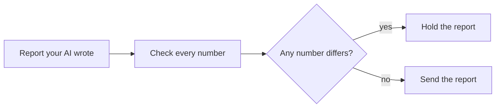

# Check AI report numbers before sending (n8n)

An n8n workflow for the step between "the AI wrote the report" and "send it". It sends the report and the spreadsheet it came from to the [Every Number check API](https://everynumber.app/agents), which counts each number again from the file. If any number differs, the run stops before the send step and says which one.



## Try it

1. In n8n, open a new workflow and paste the contents of [`check-before-sending.json`](check-before-sending.json) onto the canvas, or use *Import from File*.
2. Click *Execute workflow*. The example report has one wrong number on purpose, so the run stops with:

```
Hold this report: 1 of 9 numbers differ from the file. $38.10 (the file says $40.78). See every number marked: https://everynumber.app/check/…
```

Change `$38.10` to `$40.78` in *Report your AI wrote* and run it again. It reaches *Send the report*.

We ran both on self-hosted n8n 2.48.7 (Docker) on November 20, 2026.

## Use it with your own report

- Replace *Report your AI wrote* with your own steps. The check node needs two fields: `report` (the text) and `file_url` (a Google Sheet shared as "Anyone with the link", a Dropbox link, or a file in a public GitHub repository or gist).
- Replace *Send the report* with Gmail, Slack or whatever sends it.
- If the file can't have a public link, send its contents instead. In *Check every number*, set the body to `{ text, file_content, file_name }`. CSV goes as plain text; for Excel add `content_encoding: "base64"`.

## What it lets through

- `not_checked`: the checker reads a number when its own sentence says what it counts and for which rows and dates. A number whose client or dates appear only in a heading or a bullet above usually comes back `not_checked`, and this workflow sends it. It can also be counted for the wrong rows and come back `differs`, which holds a correct report (see the test below). The yellow note in the workflow has one line to add to your AI step's prompt to avoid both.
- `counted_differently`: the number is in the file, but on a different basis from the rest of the text. This workflow sends it too. Add a second condition to *Any number differs?* if you want to hold those.

## One small test

On November 20, 2026 we gave Claude Haiku 5.5 two of our sample exports, [ads](https://everynumber.app/samples/ads/ad-performance-2026-10-18.csv) and [sign-ups](https://everynumber.app/samples/signups/signups-week-ending-2026-10-18.csv), with an ordinary request for a weekly update. Each file got two reports: one with the request as is, one with the line from the yellow note added. We checked the four reports and recounted every number the checker called different, and every count in the sign-up reports, by hand.

| Report | Numbers | Read by the checker | Workflow | Was that right? |
|---|---|---|---|---|
| Ads, request as is | 88 | 10 | Held: 4 called different | No. All 4 were correct. The checker took the client from a heading above, or one campaign as the whole channel. |
| Sign-ups, request as is | 47 | 24 | Held: 2 called different | Yes. The report had 6 wrong counts. The checker caught 2; the other 4 were in a list and came back `not_checked`. |
| Ads, with the line | 36 | 29 | Sent | 29 confirmed, 7 not checked. |
| Sign-ups, with the line | 10 | 8 | Sent | Yes. We found no wrong numbers in it. |

With the line, the checker read 80% or more of the numbers instead of 11% and 51%, but the reports were shorter. Four reports from one model is a small test, so take it as a direction, not a score. How often the checker is right on reports it had never seen is in the [main README](../README.md#scores-so-far).

## Limits and data

- No account or key. The API takes 10 checks every 10 minutes and 40 a day from one place. Workflows that call from the same address share that limit.
- The file is read to count and is not stored. The text and the result are deleted after 24 hours. Until then, anyone with the result link can open it.
